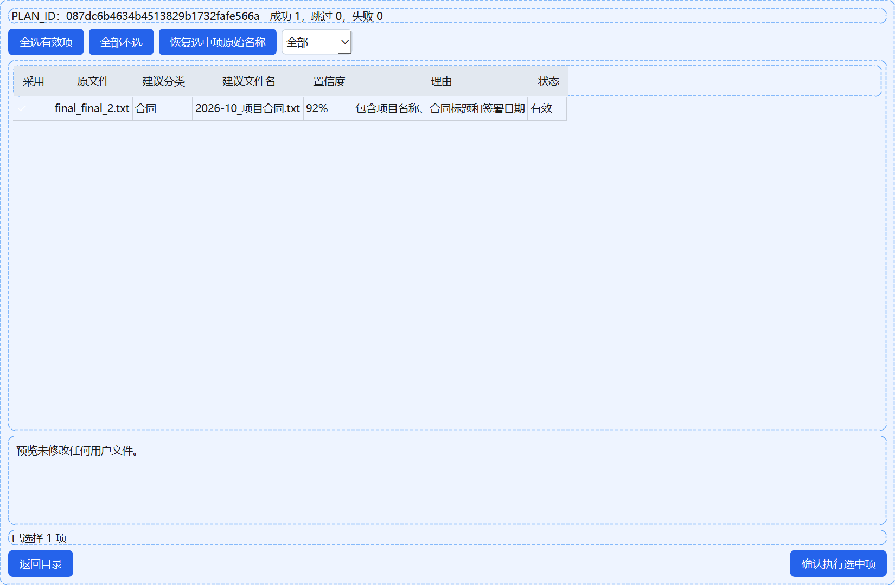

# AI File Tidy

本地优先、默认只预览的 AI 文件整理工具。读取文档内容，为文件建议更清晰的名称和分类目录；确认后再执行，并支持撤销。Windows 桌面版还支持按正文内容找文件、全文快速摘要和多版本对比。

[下载最新版](https://github.com/manwhatcanisay24/ai-file-tidy/releases/latest) · [0.3.1 发布说明](https://github.com/manwhatcanisay24/ai-file-tidy/releases/tag/v0.3.1)

## 界面预览

## 主要功能

- **AI 文件整理**：支持 TXT、MD、PDF、DOCX、XLSX 和 XLSM，按内容建议文件名及分类。
- **安全预览与撤销**：默认不修改文件；执行前检查冲突和 SHA-256，不覆盖已有文件，可从历史记录撤销。
- **按内容找文件**：使用本地中文向量模型检索正文，返回相关度排序和真实原文证据。
- **全文快速摘要**：长文完整分块提取事实后合并，生成内容摘要、关键点和建议主题。
- **多版本对比**：选择 2～20 个文件，进行正文去重、版本分组、差异定位和连续原文证据核验。
- **本地或云端模型**：内置 llama.cpp 本地运行时，也可使用 Ollama、OpenAI 兼容接口、Anthropic 或 DeepSeek。

## 下载与安装

1. 打开 [Releases](https://github.com/manwhatcanisay24/ai-file-tidy/releases/latest)，下载 `AI-File-Tidy-Setup-0.3.1.exe`。
2. 双击安装程序并按向导操作。应用安装到当前用户目录，**不需要预装 Python 或 Ollama**。
3. 安装包不包含 AI 模型，首次启动请在模型向导中准备生成模型。
4. 当前是未签名的 Windows 测试构建，系统可能显示“发布者未知”警告。

0.3.1 安装包大小：108,133,423 字节。  
SHA-256：`d1223f5fe86cd142f03abb5921c4dc8095975938a3c3a648115f87c8bf372e35`

## 使用说明

### 1. 准备生成模型

- **内置本地模型**：在首次启动向导中选择“内置本地模型”，确认模型大小、内存和许可证后下载。默认模型为 Qwen3-1.7B GGUF Q8_0，约 1.83 GB，建议至少 4 GB 可用内存。
- **外部 Ollama**：已安装并运行 Ollama 时，可在设置中选择对应模型，无需下载内置模型。
- **云端服务**：也可配置 OpenAI 兼容接口、Anthropic 或 DeepSeek。云端模式会把相应文件路径和正文内容发送给第三方服务，请先阅读隐私说明。

模型准备完成后，本地模式下的整理、内容反查、摘要和版本对比均可离线使用。

### 2. 整理和重命名文件

1. 打开应用，选择或拖入需要整理的文件夹。
2. 根据需要选择是否递归扫描子目录，然后点击“开始分析”。
3. 在计划页检查建议分类、建议文件名、置信度和理由；可双击编辑，或恢复原始名称。
4. 勾选需要采用的项目。存在非法名称、目标冲突或目标已存在的项目不能执行。
5. 点击“确认执行选中项”，核对目录和数量后主动确认。
6. 查看真实执行结果并保存 `OPERATION_ID`，需要时可打开目录或进入历史记录撤销。

默认只扫描目录第一层。分析预览只创建 `.ai-file-tidy` 元数据，不会重命名或移动文件。

### 3. 撤销整理

1. 进入“历史记录”。
2. 找到对应操作并选择撤销。
3. 确认后，应用会将本次移动的文件恢复到原始位置；如果原位置已有其他文件，则不会覆盖。

### 4. 按内容找文件

1. 打开“按内容找文件”，选择文档目录。
2. 首次使用时准备独立的中文检索模型，下载量约 24 MB。
3. 等待索引完成，输入人物、场景、关键事件或结局等描述。
4. 查看候选文件、相关度和最多 3 段原文证据，再打开原文件核对。

相关度是向量相似度，不是“正确概率”；低相关结果需要人工核对。内容反查支持 TXT、MD、PDF 和 DOCX，不包含 Excel。

### 5. 快速摘要与版本对比

- 在内容反查结果中点击“快速总结”，生成全文摘要、关键点和建议主题。
- 点击“比较所选版本”，从搜索结果、同目录相似文件推荐或手动添加的文件中选择 2～20 个版本。
- 可切换基准版本、去重、查看版本分组和关键区别；每项证据均可回到对应正文核验。
- 摘要主题和差异标签可加入后续改名计划。摘要与对比本身只读，只有明确确认改名计划后才会移动文件。

## 支持格式

| 格式 | 用途 |
| --- | --- |
| TXT、MD | 内容提取、AI 命名、内容反查、摘要和版本对比 |
| PDF、DOCX | 文本提取、AI 命名、内容反查、摘要和版本对比 |
| XLSX、XLSM | 只读提取工作表、非空单元格和公式文本，用于 AI 命名 |

不支持旧版 DOC、XLS、PPT，不进行扫描件 OCR，也不执行 Excel 宏或公式。

## 安全与隐私

- 默认只预览，不自动重命名、移动、合并或删除用户文件。
- 不覆盖已有文件；执行前重新检查源文件哈希和目标冲突。
- 本地模型准备好后，核心功能可离线完成；云端 Provider 会发送相应正文内容。
- 搜索索引和分析缓存保存在当前用户应用缓存目录，未加密，但不保存 API Key。
- 普通改名只发送截断正文；全文摘要和版本对比在云端模式下会发送完整正文分块或其事实、差异片段。

## 验证与平台范围

- 0.3.1 的 102 项自动化测试全部通过。
- 已完成 Windows 安装、启动、卸载及真实本地模型验收。
- 当前仅提供 Windows x64 桌面安装包；macOS 和 Linux 安装包尚未构建或实测。

## 下载

前往 [Releases](https://github.com/manwhatcanisay24/ai-file-tidy/releases) 获取安装包、SHA-256 校验文件和完整发布说明。
